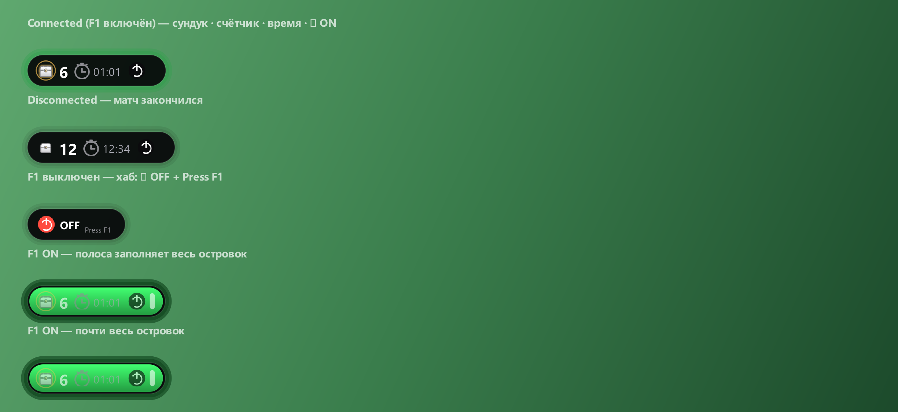

# Fortnite Chest Tracker

Мини-оверлей в стиле «Dynamic Island»: маленькая чёрная капсула висит сверху экрана
**поверх Fortnite** и показывает сундук, общий счётчик открытых сундуков, текущее время
компьютера и индикатор: **зелёная точка** — счёт включён, **красная** — выключен.
Компактный: высота всего 34 px.

**Появление.** Пока Fortnite не запущен, островка не видно. Через 10 секунд после старта
игры он плавно вырастает из точки до полной ширины; когда игра закрывается — так же
плавно сворачивается. Задержка меняется в `settings.json` (`open_delay`, секунды).

**Счётчик не сбрасывается.** Общее число сундуков хранится в `settings.json`
(`chests_total`) и переживает перезапуск программы и игры.



* **красная точка** — счёт выключен (хаб «OFF · Press F1»);
* **зелёная точка** — счёт включён;
* сундук — один спокойный цвет, без «редкостей» и легендарных.

## Запуск

```
двойной клик по «Fortnite Chest Tracker.lnk»   (или start.cmd)
```

В комплекте `runtime/` — карманный Python 3.12 + Qt (PySide6); ставить ничего не нужно.
В трее появится иконка, в трее же — Pause (F1) / Hide island / Quit.

| Действие (клавиша по умолчанию) | Что делает |
|---|---|
| **F1** | Включить трекинг: **полоса-загрузка заливает весь островок** зелёным, затем появляется счётчик. Повторное нажатие — полоса стекает обратно, и островок возвращается в хаб «⏻ OFF · Press F1». |
| **F2** | +1 сундук (ручной счёт, пока Fortnite сам не сообщает о сундуках) |
| **F3** | −1 сундук (исправить ошибку) |
| **Numpad +** | Переставить островок: верх → центр → низ (запоминается) |

### Свои клавиши и боковые кнопки мыши

Иконка в трее → **Hotkeys…**. Нажмите кнопку напротив действия и затем нужную клавишу
или кнопку мыши — подойдёт любая, включая **боковые кнопки мыши** (Mouse 4 / Mouse 5) и
среднюю. **Esc** — отмена, **×** — снять привязку, «Сбросить» — вернуть F1 / F2 / F3.
Можно назначить: включить/выключить счёт, +1 сундук, −1 сундук, сдвинуть островок.
Если клавиша уже занята другим действием, она переходит к новому, а у старого
привязка снимается. Настройки хранятся в `settings.json` (`keys`).

Программа только *читает* состояние клавиш и ничего не перехватывает: назначенная
кнопка продолжает работать и в игре. Поэтому лучше выбирать те, что в Fortnite не заняты.
Если боковые кнопки переназначены в фирменной программе мыши (G Hub, Razer Synapse),
выбирайте то, что реально приходит в Windows — окно привязки покажет это сразу.

`start.cmd --demo` — посмотреть, как всё выглядит, без игры. `start.cmd --always` —
показывать островок всегда, даже когда Fortnite не запущен (то же — пункт
«Show without Fortnite» в меню трея).

## Как это устроено

```
run.py                 точка входа (подключает runtime/site)
chest_tracker/
  app.py               трей, горячие клавиши, мост, оверлей
  island.py            островок: вёрстка, морфинг, полоса F1, отрисовка
  icons.py             векторные иконки: сундук, секундомер, ⏻, смайлики
  overlay.py           прозрачное click-through окно поверх игры
  hook.py              опрос клавиш и кнопок мыши (GetAsyncKeyState, без хуков)
  keys.py              привязки действий к клавишам (по умолчанию F1 / F2 / F3 / Numpad+)
  keybinds.py          окно «Hotkeys…»: нажать действие → нажать клавишу
  gamewatch.py         запущен ли Fortnite (список процессов)
  events.py            локальный HTTP-мост для событий из игры
  tracker.py           состояние: счётчики, таймер, потокобезопасные события
  theme.py             цвета, размеры
hud.html               страница, которую открывают ВНУТРИ игры
tools/                 сборка рантайма, иконки, тесты
```

## События из игры

Fortnite не отдаёт наружу, что вы открыли сундук, а читать память игры нельзя (античит).
Поэтому трекер принимает события по локальной сети в обход игры:

1. Трекер слушает `http://127.0.0.1:4783` (`/event`, `/ping`, `/hud.html`).
2. `hud.html` открывается в игре (Creative-остров / второй экран) и шлёт события.
3. На старте матча — `connected`, на каждый сундук — `chest`, в конце — `disconnected`.

Формат — любой из этих (удобно для разных мостов острова):

```json
{"tier":"common"}
{"rarity":"epic"}
{"type":"chest"}
{"type":"connected"}
{"type":"disconnected"}
{"type":"toggle"}
```

Проверка с ПК:

```powershell
curl.exe -X POST http://127.0.0.1:4783/event -d "{\"type\":\"chest\"}"
curl.exe http://127.0.0.1:4783/ping
```

Источник «сундук открыт» на своём острове в UEFN — событие сундука
[`OpenEvent`](https://verseisland.com/reference/devices/hero-chest-device). В официальных
BR / Zero Build публичного API у Epic нет — там счёт наполняет кнопка на `hud.html`.

## Ресурсы

| Метрика | Значение |
|---|---|
| ОЗУ, рабочий набор | ≈ 78 МБ (из них ~40 МБ Qt) |
| ОЗУ, частная | ≈ 38 МБ |
| CPU | ~0.5 % ядра; в простое рисуется только раз в секунду |
| Размер на диске | ~88 МБ (Python + Qt внутри) |

## Настройки

`%LOCALAPPDATA%\FortniteChestTracker\settings.json` — `visible`, `position` (`top` / `middle` / `bottom`),
`keys` (привязки), `chests_total` (общий счётчик), `open_delay` (секунды до появления после запуска Fortnite).

## Если что-то не так

* **F1 не переключает** — опрос клавиш не запустился; пользуйтесь «Pause (F1)» в трее.
* **Островка не видно поверх игры** — включите в Fortnite оконный режим (Windowed / Windowed Fullscreen).
* **hud.html ничего не отправляет** — трекер должен быть запущен; если мост занял другой порт,
  откройте `hud.html?port=4784`.

## Пересборка рантайма и тесты

```cmd
python tools\setup.py            :: скачать CPython + PySide6, разложить runtime/
python tools\slim_runtime.py     :: убрать QML/Quick/доки/pdb
python tools\restore_runtime.py  :: вернуть файлы Qt из колеса без сети
python tools\e2e_test.py         :: запуск приложения, мост, замер ОЗУ
python tools\logic_test.py       :: F1, пауза, перестановка
python tools\make_sheet.py       :: превью всех состояний
```

## Лицензии

Код трекера — свободно. В `runtime/`: CPython (PSF), Qt 6 (LGPL-3.0),
PySide6/shiboken6 (LGPL-3.0), шрифты Segoe UI / Segoe UI Variable (Microsoft).
